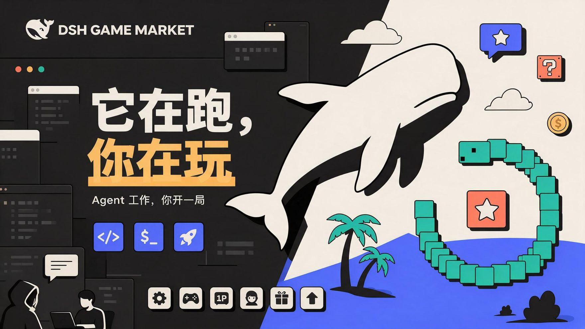
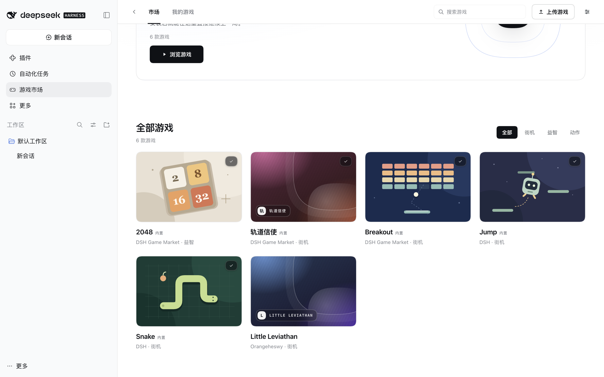
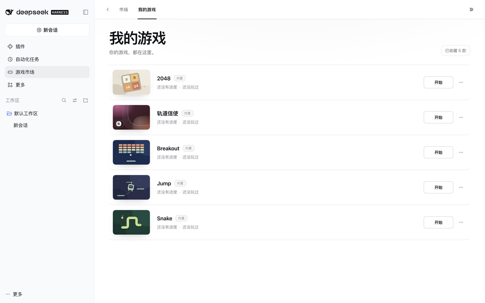
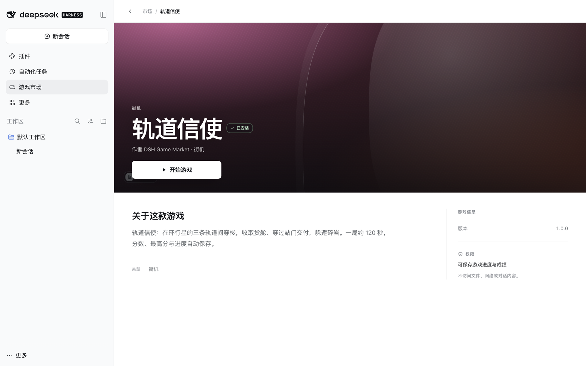
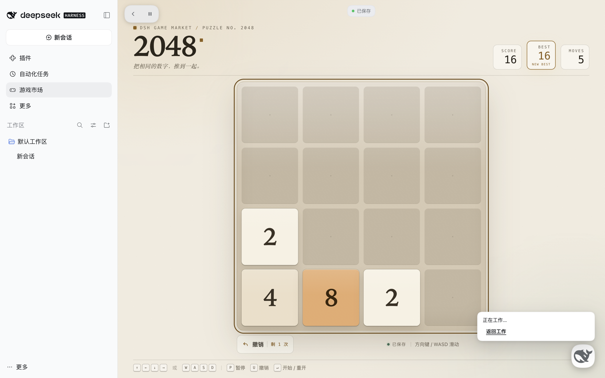
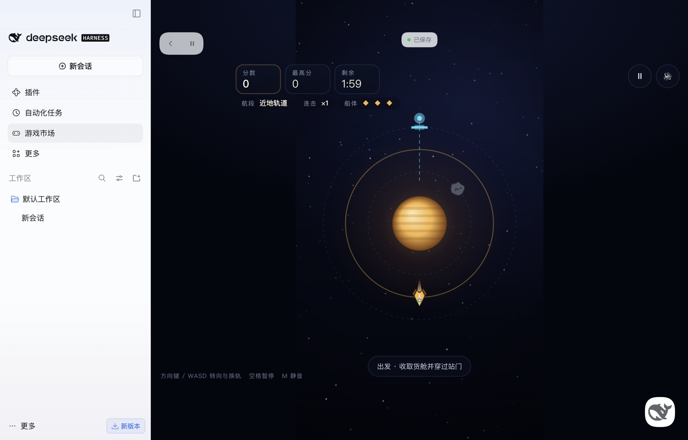
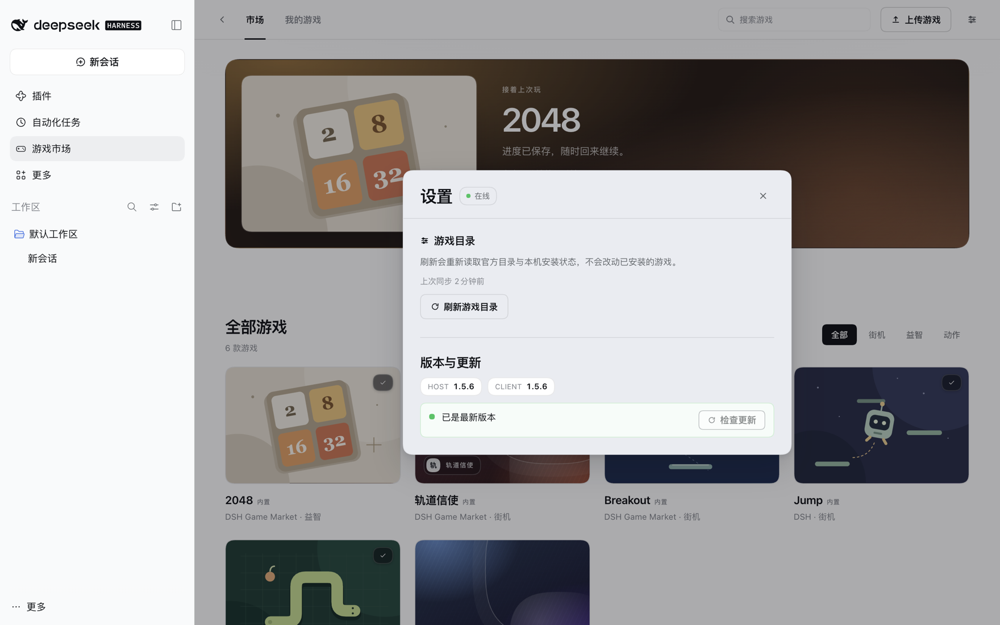

<a name="中文"></a>
<div align="center">



<h1>DSH Game Market</h1>

<p><b>把大肥鱼干活的时间，变成一局游戏。</b></p>

<p>DeepSeek Harness 里的游戏市场。<br>
大肥鱼忙着跑任务时，你在旁边开一局；右下角的小鲸鱼替你盯着进度，需要你时叫你一声。游戏自动存档，下次接着玩。<br>
开发者的游戏也能投进来，审核通过后上架，所有人可玩。</p>

<p>
  <a href="https://github.com/heswy/dsh-game-market/tree/v1.5.6"></a>
  <a href="LICENSE"></a>
  
  = 20">
</p>

<p><a href="#中文"><b>中文</b></a> · <a href="#english">English</a></p>

</div>

---

## 它能做什么

- Agent 跑长任务时，游戏占满 DSH 的主工作区。
- 右下角的鲸鱼显示 Agent 状态：运行中、等你、完成、出错；任务完成会提醒，但不打断游戏。
- 进度自动保存，关掉 DSH 再打开可以继续；也可以导出成 JSON 换机器。

---

## 安装

1. 侧栏「插件」→「添加插件」，填入仓库地址：`https://github.com/heswy/dsh-game-market`
2. 装完后重启 DSH。
3. 侧栏出现「游戏市场」。

装的是最新发布版（当前 1.5.6）。需要 DSH `>=0.2.0 <0.3.0`、Node `>=20`。

---

## 看一眼

<div align="center">

<br>
<sub>市场：全部游戏（5 款内置 + 1 款社区游戏）</sub>
</div>

<br>

<table>
<tr>
<td width="50%"></td>
<td width="50%"></td>
</tr>
<tr>
<td><sub><b>我的游戏</b>：5 款内置游戏</sub></td>
<td><sub><b>游戏详情</b>：玩法、权限与游戏信息</sub></td>
</tr>
</table>

<br>

<div align="center">

<br>
<sub>2048 实玩：右下角鲸鱼显示 Agent 正在工作（截图版本 1.5.6）</sub>
</div>

<br>

<div align="center">

<br>
<sub>轨道信使全屏游玩（截图版本 1.5.0-rc.3）</sub>
</div>

---

## 5 款内置游戏

| 游戏 | 类型 | 怎么玩 |
| --- | --- | --- |
| **Snake** | 街机 | 方向键 / WASD 控制方向，收集食物，避开自己 |
| **轨道信使** Orbit Courier | 街机 | 在环行星的三条轨道间穿梭，收取货舱、穿过站门交付，躲避碎岩；一局约 120 秒 |
| **2048** | 益智 | 4×4 滑动合并相同数字，冲击 2048；每局一次撤销 |
| **Jump** | 街机 | 纵向平台跳跃，自动弹跳，踩移动 / 易碎 / 弹簧平台 |
| **Breakout** | 街机 | 鼠标或方向键移动挡板反弹球，击碎砖块，闯过 5 个关卡 |

5 款游戏全部内置，随插件打包，安装后即列出，5 款都带「内置」徽标。

官方目录另收录社区游戏：当前 1 款 Little Leviathan（维护者示例投稿，用于验证投稿 → 审核 → 上架链路）。

---

## 核心能力

### 游戏中

游戏铺满主工作区，顶部是返回 / 暂停，右下角是小鲸鱼。

- 暂停菜单：继续、保存并返回工作。
- 从会话回来，游戏停在原处。
- 游戏结束时提交分数，最高分与历史在「我的游戏」里。

### 小鲸鱼

右下角的小鲸鱼显示 Agent 状态：

| 状态 | 显示 |
| --- | --- |
| 运行中 | 点开可以继续上一局，或挑一个游戏 |
| 等你 | 「Agent 在等你 · 去看看」，处理审批或提问 |
| 完成 | 「任务完成啦 / 查看结果」，不暂停、不关闭游戏 |
| 出错 | 「遇到了一点问题」，点开回会话看原因 |

会话 tab 行还有状态 pill：等你 / 完成 / 出错 / 已暂停。

### 存档与 Continue

- 暂停、切后台、离开游戏和 Agent 等待时，进度自动保存。
- 关掉 DSH 再打开，游戏显示 Continue 和上一局分数。
- 每款游戏只能使用 `storage` / `score` 两项能力，配额是 32 个键、单值 256 KiB、单游戏 1 MiB。
- 进度可以导出成 JSON 在另一台机器导入，文件只含游戏标识、版本、存档 schema、键值和校验和。

### Agent 提问时，在游戏里回答

Agent 需要你回答普通问题时，游戏暂停，问题面板出现在游戏上：选答案、补充文字、提交，然后继续游戏。

危险工具授权仍然回到 DSH 原生审批，不在游戏里处理。

### 平台更新

设置里的「版本与更新」显示当前 Host / Client 版本、目标版本与发布通道。一次更新会：

1. 暂停并保存正在运行的游戏；
2. 由 DSH 插件管理器按官方索引钉住的 Git 提交安装；
3. 由 Host 与 Client 各自上报身份，双端核验一致才算完成；需要重启时提示「已安装，重启 DSH 后生效」。

<div align="center">

<br>
<sub>设置 → 版本与更新：Host / Client 版本与更新核验</sub>
</div>

另外：市场首页 / 我的游戏 / 详情 / 搜索 / 分类；本地安装 `.html` / `.dshgame.zip`；多文件资源包（`asset-zip-v2`）。

---

## 给游戏开发者

### SDK v1

```js
const game = DSH_GAME_SDK.createGameSDK();

// 在 ready 之前注册生命周期：pause / resume / before-save / hidden / visible
game.lifecycle.on('before-save', () => saveNow());

const info = await game.ready();          // 握手：主题与语言
const saved = await game.storage.load('current');   // 读档，缺失返回 null
await game.session.start();

await game.score.submit(score);           // 交分数
await game.session.end({ outcome: 'completed', score });
```

### CLI

```bash
dsh-game create my-game --template vanilla   # 或 react（也可用 create-dsh-game）
cd my-game
npm run build && npm run validate && npm run pack
npm run dev                                   # 本地 Runtime Simulator，无需真实 Agent
```

| 命令 | 作用 |
| --- | --- |
| `dsh-game create <id>` | 从 Vanilla / React 模板生成工程 |
| `dsh-game build` | 打成确定性单文件，或 `asset-zip-v2` 资源包 |
| `dsh-game validate` | 与平台同一套校验（含运行时契约） |
| `dsh-game dev` | 本地 Runtime Simulator，模拟暂停 / 存档 / 读档 |
| `dsh-game pack` | 产出 `<id>-<version>.html` + `.sha256` |
| `dsh-game publish` | 生成目录条目、上传计划与审核清单 |

### 文档

- [开发者指南](docs/developer-guide.md)：manifest、SDK、Runtime 安全区、双格式与发布。
- [CLI 参考](docs/developer-cli.md)：命令的选项、退出码与离线用法。
- [开发 Skill](skills/dsh-game-developer/SKILL.md)：把玩法到打包验证的流程交给 AI。

游戏运行在 `sandbox` iframe 里，页面 CSP 为 `default-src 'none'`、`connect-src 'none'`；能力只有 `storage` 与 `score`；全出血，顶部 112px / 右下 96×96 安全区留给平台控件。

---

## 社区投稿

社区游戏目录是一个独立的 GitHub 内容仓库：**[heswy/dsh-game-registry](https://github.com/heswy/dsh-game-registry)**。

1. 按[投稿指南](docs/community-submission.md)准备包：`dist/<id>-<version>.html`（或 `.dshgame.zip`）+ `.sha256`、封面、截图、公开源码与固定 commit、`submission.json`。
2. 在内容仓库开 [**Submit a game** Issue Form](https://github.com/heswy/dsh-game-registry/issues/new?template=submit-game.yml)（或提资料 PR）。
3. 维护者下载你声明的确切字节校验并试玩，通过后记录 approval、运行上架工具；合并 catalog PR 后用户刷新市场即可看到。
4. 更新时递增版本重新提交，同版本不能替换字节，已发布版本永久保留。

> 官方社区目录已开通：首个投稿位，留给你。

维护者流程见[运营手册](docs/community-operations.md)，字段与审核契约见[投稿契约](docs/community-publishing-contracts.md)。

---

## 安全与隐私

- **沙箱运行**：游戏跑在 `sandbox` iframe 中，入口文档 CSP 为 `default-src 'none'`、`connect-src 'none'`、`frame-src 'none'`，不能发起网络请求，也读不到 DSH 的页面与数据。
- **最小权限**：游戏 manifest 只能声明 `storage` / `score`；详情页会说明权限（例如「可保存游戏进度与成绩 · 不访问文件、网络或对话内容」）。
- **数据在本地**：存档、最高分存在本机；导出的进度文件只含游戏进度字段与校验和。
- **更新保守**：安装/更新交给 DSH 插件管理器执行；平台不覆盖自己的文件，不忽略重启要求，不把「回答问题」当成「批准执行」。
- **本地安装**：从本地安装 `.html` / `.dshgame.zip` 不校验来源，只装你信任的文件。

---

> **网络较慢时安装社区游戏失败？**
> 如果提示 `GM-5035`（下载超时），点「重试」即可——这是到 GitHub 的连接超时，不是包损坏；插件会自动重试 2 次，仍失败时手动重试通常在网络恢复后一次成功。

---

## 版本与兼容

| 项 | 值 |
| --- | --- |
| 当前版本 | **v1.5.6**（2026-11-02），tag `v1.5.6`，发布提交 `6637faa` |
| 兼容 DSH | `>=0.2.0 <0.3.0` |
| Node | `>= 20` |
| 验证 | `node --test` 1580 例：1575 通过 / 4 跳过 / 1 例环境相关失败（干净 CI 为 0 fail）；`CHECK OK (45)`；安装产物 93 文件 / 3,511,894 字节 |
| 许可证 | MIT © 2026 heswy |

<details>
<summary>更新记录</summary>

| 版本 | 内容 |
| --- | --- |
| v1.5.0 | 首版公开发行：多文件资源包、平台自更新、游戏内问答、可移植存档、市场前端改版 |
| v1.5.1 | 修复 DSH 0.2.1-rc.5 下会话标题栏不渲染、游戏入口消失 |
| v1.5.2 | 「无需保存」不再误报为保存失败 |
| v1.5.3 | 保存提示移入会话标题栏，跟随宿主语言 |
| v1.5.4 | 目录索引增加 jsDelivr / GitHub API 镜像降级，在线状态收进设置 |
| v1.5.6 | 2048 / Breakout / Jump 改为内置：全新安装即列出 5 款内置游戏 |
| v1.5.5 | 「版本与更新」面板重做：四步步骤条、状态徽章、描边按钮与版本胶囊 |

每个版本的完整说明在 [`docs/releases/`](docs/releases/)。

</details>

---

## 路线图

| 方向 | 状态 |
| --- | --- |
| 社区游戏上架（目录已开通，首个投稿位开放） | 已开放 |
| 实体硬件跨机迁移验证（功能已在独立主机通过，实体机未实测） | 待补验证 |
| 三个能力 seam（资源路由 / 受限解压 / 问答领域接口）等待 DSH 上游支持 | 待上游 |
| 多人联网、账号、付费、云排行榜、云存档同步 | 暂不做 |

当前版本明确不做的还有：游戏内处理危险操作审批、接管 DSH 品牌或自动更新、在游戏包里放安装脚本或任意可执行 Host 扩展。

---

## 文档地图

| 文档 | 内容 |
| --- | --- |
| [开发者指南](docs/developer-guide.md) | 从模板到上架 |
| [CLI 参考](docs/developer-cli.md) | 命令行与退出码 |
| [投稿指南](docs/community-submission.md) | 作者投稿流程 |
| [运营手册](docs/community-operations.md) | 维护者审核与上架 |
| [投稿契约](docs/community-publishing-contracts.md) | 字段、字节与审核绑定 |
| [V1.5 契约](docs/V1.5-CONTRACTS.md) | 包格式、安全边界、更新协议 |
| [发布流程](docs/plugin-update-release.md) | 版本、索引与发布 |
| [发布记录](docs/releases/v1.5.6.md) | 每个版本改了什么 |

---

## 许可证与致谢

本项目以 **MIT** 许可发布，作者 [heswy](https://github.com/heswy)。

- 小鲸鱼使用 DeepSeek Harness 运行时的官方 `FishLogo` 组件（MIT），不复制、不热链官方图形资产；本项目不声称 DeepSeek 官方背书。
- 运行时唯一新增依赖 `yauzl@3.4.0`（+ 传递依赖 `pend@1.2.0`，均 MIT），只用于 `asset-zip-v2` 解包，明细见 [THIRD-PARTY-NOTICES.md](THIRD-PARTY-NOTICES.md)。

---

# English

<div align="center">

<h2>DSH Game Market</h2>

<p><b>While the big fish grinds, you play.</b></p>

<p>The game market inside DeepSeek Harness.<br>
Games fill the main workspace while the Agent works; the little whale keeps watch, calls you when it needs you, and your run auto-saves for next time.<br>
Developers can submit their own games too: once reviewed, they go live for everyone.</p>

<p><a href="#中文">中文</a> · <b>English</b></p>

</div>

### What it does

- While the Agent works on a long task, a game fills DSH's main workspace.
- The whale in the corner shows the Agent state: running, needs-you, done, error. Completion is announced without interrupting the game.
- Progress auto-saves and can be continued after a DSH restart; it can also be exported as JSON and imported on another machine.

### Install

1. **Plugins** in the DSH sidebar → **Add plugin**, and enter `https://github.com/heswy/dsh-game-market`
2. Restart DSH.
3. **Game Market** appears in the sidebar.

Installs the latest release (currently 1.5.6). Requires DSH `>=0.2.0 <0.3.0` and Node `>=20`.

### The five built-in games

| Game | Genre | How it plays |
| --- | --- | --- |
| **Snake** | Arcade | Arrow keys / WASD, collect food, avoid yourself |
| **Orbit Courier** | Arcade | Switch between three orbital lanes, collect cargo, pass station gates, dodge debris; ~120 s a run |
| **2048** | Puzzle | Slide and merge on a 4×4 board, one undo per run |
| **Jump** | Arcade | Endless vertical platformer with moving, fragile and spring platforms |
| **Breakout** | Arcade | Mouse or arrow keys, bounce the ball, clear 5 levels |

All five games are built in and ship with the plugin; a fresh install lists all five in My Games, each marked as built-in.

The official catalog adds community games: currently one, Little Leviathan (a maintainer example submission that exercises the submit → review → publish path).

### Core features

- **In game** — the game fills the main workspace; back / pause at the top, the whale at the bottom right. The pause menu offers resume, or save and return to work. Scores and best results live in My Games.
- **Whale presence** — four states (running, needs-you, done, error), plus status pills on the session tab row.
- **Saves** — auto-save on pause, background, leaving and Agent waits; Continue after a DSH restart; 32 keys, 256 KiB per value, 1 MiB per game. Portable JSON export/import across machines.
- **Questions in game** — a normal Agent question pauses the game and opens in place; dangerous approvals stay in DSH's native flow.
- **Platform updates** — Settings → Version & updates pauses and saves games, installs the Git commit pinned by the official index through DSH's plugin manager, verifies host and client identities, and asks for a restart only when needed.
- Also: market home / My Games / details / search / categories; local `.html` and `.dshgame.zip` installs; multi-file packages (`asset-zip-v2`).

### For game developers

```bash
dsh-game create my-game --template vanilla
cd my-game && npm run build && npm run validate && npm run pack
npm run dev     # local Runtime Simulator, no real Agent needed
```

Games run in a sandboxed iframe with `default-src 'none'` and `connect-src 'none'`: no network, no access to DSH files or conversations, only `storage` and `score` capabilities. Docs: [developer guide](docs/developer-guide.md), [CLI reference](docs/developer-cli.md), [developer Skill](skills/dsh-game-developer/SKILL.md).

### Community

The community catalog lives in [heswy/dsh-game-registry](https://github.com/heswy/dsh-game-registry). Prepare a package and screenshots, open the **Submit a game** issue form, and a maintainer reviews, plays and publishes it through a catalog PR. The first submission slot is open.

> **Community game install failed on a slow network?**
> If you see `GM-5035` (download timeout), press **Retry** — the connection to GitHub timed out; the package is not corrupt. The plugin retries twice automatically; if it still fails, a manual retry usually succeeds once the network recovers.

### Compatibility

| Item | Value |
| --- | --- |
| Current version | **v1.5.6** (2026-11-02), tag `v1.5.6`, release commit `6637faa` |
| DSH | `>=0.2.0 <0.3.0` |
| Node | `>= 20` |
| Verification | `node --test`: 1580 tests, 1575 pass, 4 skip, 1 environment-related failure (0 fail on clean CI); `CHECK OK (45)`; 93-file / 3,511,894-byte artifact |
| License | MIT © 2026 heswy |

Out of scope for now: multiplayer, accounts, payments, cloud leaderboards, cloud saves, handling dangerous approvals inside the game, or shipping install scripts / arbitrary host extensions inside game packages.

---

<div align="center">
<sub>DSH Game Market · MIT · built for DeepSeek Harness</sub>
</div>
