# V0 验证记录

- 日期：2026-10-18
- 版本：`dsh-game-market@0.0.0`（V0）
- 目标：证明 PRD §7.1 的核心链路在真实 DSH 0.2.1-rc.2 宿主中成立
- 结论：**V0 核心链路验证通过**；自动化测试与真机 UI 验证均完成（详见下文"未覆盖项"）

## 1. 验证环境

| 项 | 值 |
|---|---|
| DSH | Desktop `0.2.1-rc.2`（与用户当前桌面端一致；从本机 `app.asar` 读取） |
| 宿主运行方式 | 从同一 `app.asar` 解出 DSH runtime，用**隔离的 `DSH_HOME`**（`/tmp/dsh-verify-home`）启动 `dsh web`，不触碰用户 `~/.dsh/profiles/desktop` |
| 浏览器 | Google Chrome 155 headless（CDP 9333），视口 756×469 |
| 插件加载 | 开发态 profile patch 指向仓库绝对路径 `index.js`（`devMode: true`） |
| Agent 状态模拟 | Host `POST /api/game-market/dev/agent-state`（仅 devMode）模拟 running / waiting-user / completed；UI 链路与真实事件共用同一 Adapter 输出 |
| Node | v24.14.0 |
| 截图 | 仓库 [`docs/verification/v0/`](./verification/v0/) 下 7 张关键截图 |

> 说明：本次 UI 验证使用同一版本 `app.asar` 的 Web 宿主 + headless Chrome，而不是桌面窗口本身；Client/Host/游戏代码完全一致。桌面端的窗口 chrome / 拖拽带属于同一宿主实现，本次不涉及改动的部分。

## 2. 自动化结果

```text
npm run build     → client.js 306,872 bytes；snake dist 92,815 bytes；连续构建 sha256 一致
npm run check     → CHECK OK (13 checks)
npm test          → 312 tests / 312 pass / 0 fail
```

覆盖：
- Host：路由/信封/错误码、存储原子写与损坏恢复、save 配额与冲突、session 幂等、score、preferences、agent adapter 五态、launch/entry CSP、dev 路由（73 tests）
- Client：store/reducer、chip 状态机（5s/忽略/优先级）、轮询与 ETag、pausedGame→resume、locale 完整性、launch 守卫、Runtime adapter（52 tests）
- Runtime/SDK：桥协议校验、握手/超时、请求限额、自动保存调度、resume-paused 状态迁移、SDK 全 API、Runtime↔SDK loopback（123 tests）
- 集成：`tests/v0-flow.test.js` 走通 health→games→launch→entry→save→session→Continue→score→preferences→agent→ack→end

## 3. V0 验收清单（PRD §10.2）

| 编号 | 验收项 | 结果 | 证据 |
|---|---|---|---|
| V0-01 | 插件安装/启用/停用清理 | **通过** | 隔离 profile 加载成功；停用并重启后 `Game Market` 按钮为 0、`[class*="dgm-"]` 节点为 0 |
| V0-02 | 主面板切换、Sidebar 保留 | **通过** | 点击 Sidebar 图标进入 Market；返回 Conversation（截图 01/02） |
| V0-03 | Conversation 草稿保留 | **通过** | 输入 `draft-check-42` → 进入 Market → 返回，草稿仍在 |
| V0-04 | 常驻游戏入口 | **通过（V0.2 调整）** | 会话 tab 行常驻「游戏 / Game」tab（不依赖 Agent 状态、不隐藏）；点击进入 Game Market |
| V0-05 | 入口菜单与忽略频控 | **已被 V0.2 取代** | 用户要求入口常驻、无需 5s 延迟/忽略机制；原 header chip 菜单与忽略逻辑移除，Sidebar 状态点保留 |
| V0-06 | Sidebar 状态点 | **通过** | running / waiting / completed 均出现对应状态点（截图 05/08/10） |
| V0-07 | 游戏加载与键盘 | **通过** | sandbox iframe 正常加载；点击画布后方向键可移动蛇、吃食物逻辑运行（截图 04） |
| V0-08 | Agent Presence 运行态 | **通过** | 鲸鱼 aria-label `Agent 状态：正在工作…。按下返回工作`；完成后切换完成态 |
| V0-09 | 完成提醒不打断 | **通过（V0.3 修复真实事件源）** | 游戏继续运行，鲸鱼展示 `任务完成啦 / 查看结果`；V0.3 前 Host 订阅了错误的 Cordis 事件名，真实 DSH 完成事件收不到，已改为 `session/event` |
| V0-10 | 需要用户 / 返回游戏 | **通过（V0.2 调整）** | 鲸鱼等待态 → 暂停存档 → 回到 Conversation；再次进入游戏时**只保留平台的一次「已恢复上一局」确认**，确认后直接开始游戏（不再出现游戏内第二个遮罩） |
| V0-11 | 自动保存 / Continue / 跨重启 | **通过** | 存档文件 revision 递增、`.bak` 存在；退出→市场显示 Continue；重启 Host 后 Continue 仍可恢复 |
| V0-12 | 存档原子性与恢复 | **通过（自动化）** | Host 测试覆盖 tmp→fsync→.bak、损坏恢复、只读模式；Live 额外观测到多次 revision 与备份文件 |
| V0-13 | 错误与恢复 UI | **通过** | 集成测试覆盖错误码；Live 中真实观测到 `游戏加载超时 / 问题编号 GM-5001` 错误卡与返回路径（CSP 问题修复前） |
| V0-14 | 多 Session 绑定 | **通过** | 新开 Session B 后只跟随 B；旧 Session A 设 running 不显示 chip；B 设 running 才显示 |
| V0-15 | 插件停用清理 | **通过** | 同 V0-01；无残留 DOM/样式/按钮 |

## 4. 关键截图

| 截图 | 内容 |
|---|---|
| 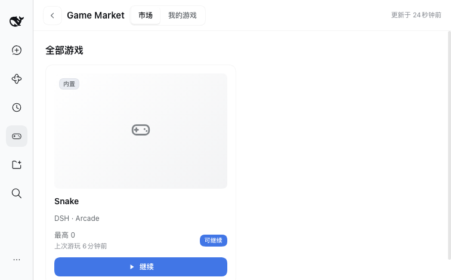 | Market 首页（内置 Snake、Continue 状态） |
| 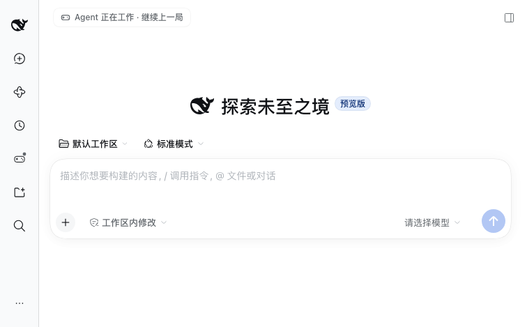 | 会话头等待入口（5s 后出现） |
| 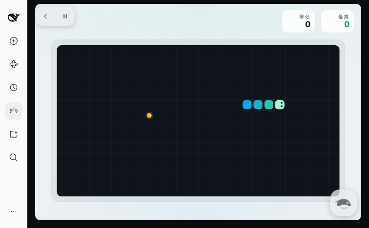 | Game Runtime 内运行贪吃蛇 |
| 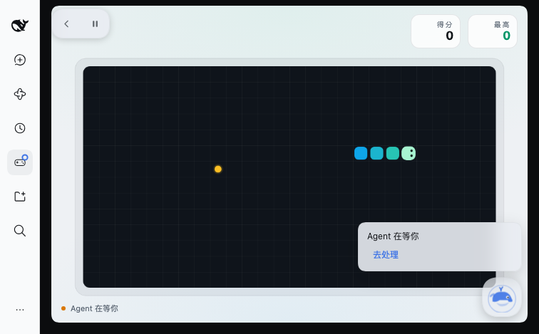 | waiting-user 鲸鱼气泡（游戏内） |
|  | running 鲸鱼状态（Agent 正在工作） |
| 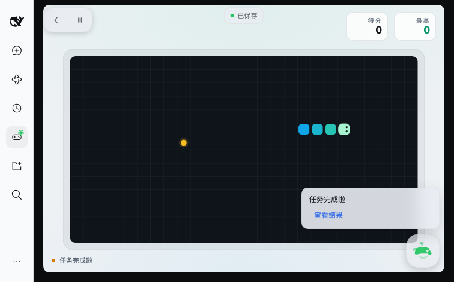 | 完成提醒（不打断游戏） |
| 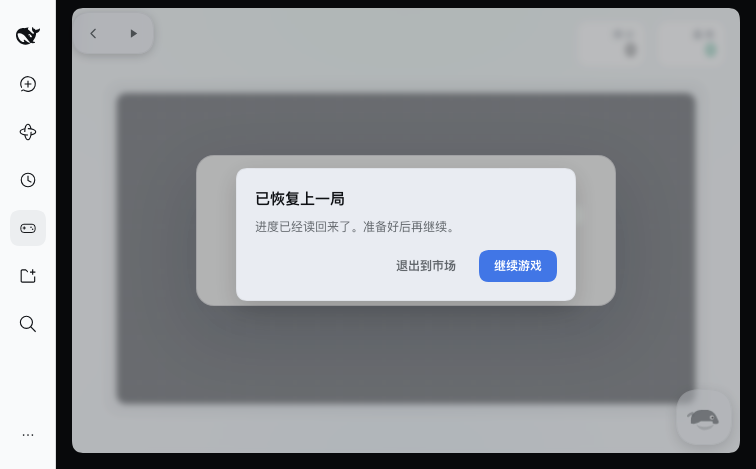 | 返回游戏时的“已恢复上一局”暂停遮罩（D-024） |
| 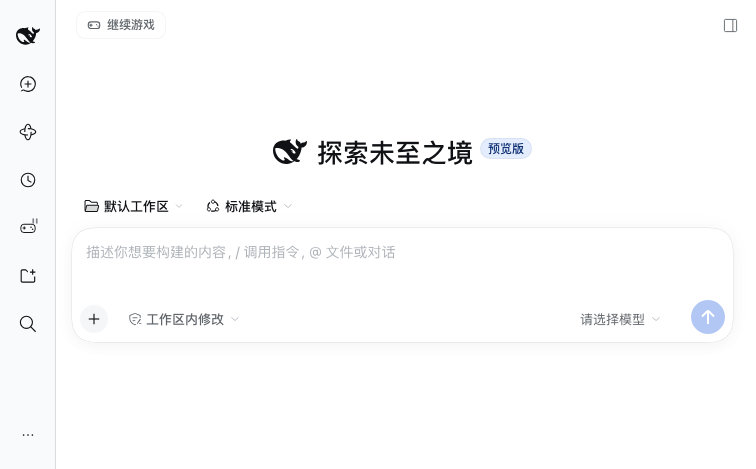 | 会话头“继续游戏”入口 |

## 4.1 V0.1 反馈迭代（2026-10-18 晚）

根据用户真机反馈做了三项修复，均已重新构建并验证：

1. **等待提示位置与形态**：从输入框 dock 移到会话头标题右侧（`conversation.session.header.actions`），显示短标签「游戏 / Game」（随界面语言）；加入游戏手柄轻摆、星点闪烁、渐变高光与等待态呼吸光晕，全部尊重 `prefers-reduced-motion`。
2. **弹层对齐**：菜单以提示为锚点水平居中，下方空间不足时向上翻转并限制在视口内，不再出现浮动层错位。
3. **返回后游戏卡住**：根因是 `resume-paused` 的 pause/resume 与游戏异步 boot 存在竞态——resume 可能早于存档加载完成；且存档状态为 `ready`（玩家尚未按方向键）时，旧逻辑会隐藏遮罩但棋盘不推进、键盘焦点仍在父页面，形成“静止棋盘”。
   修复：游戏记录提前到达的 resume；新增 `resume.js` 纯策略（running → 恢复运动；ready → 保留游戏自己的开始入口）；恢复后把键盘焦点交还给 canvas。现已覆盖单元测试与真机验证。

| 截图 | 内容 |
|---|---|
| 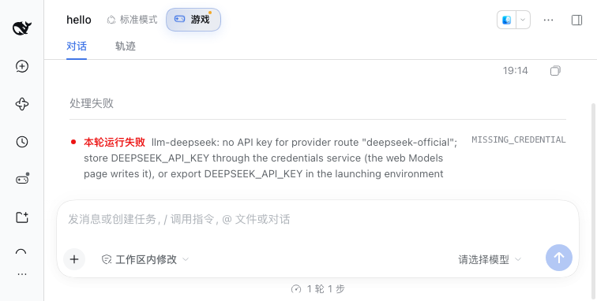 | 会话头「游戏」提示 |
| 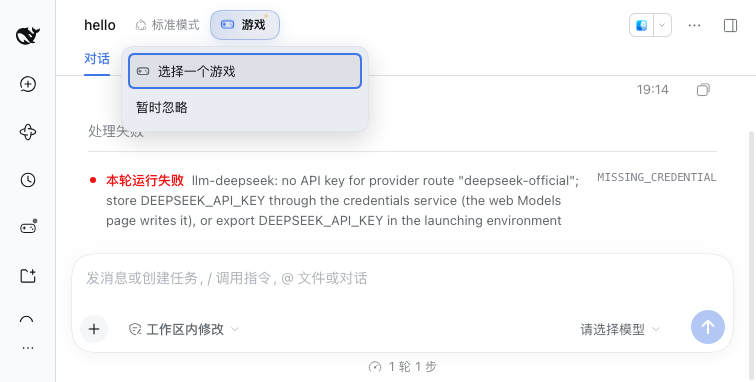 | 居中对齐的菜单 |
| 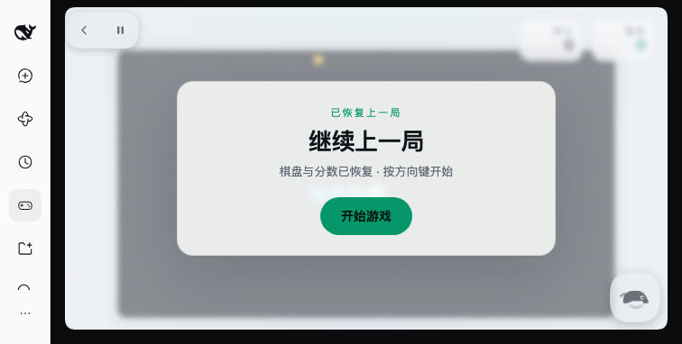 | 未开始棋盘恢复后的明确入口（不再静止卡住） |
| 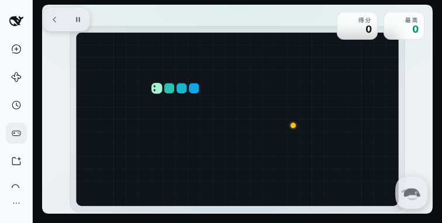 | 运行中棋盘恢复后继续游戏 |

自动化：`npm test` → **315 tests / 315 pass**。

## 4.2 V0.2 反馈迭代（2026-10-18 晚第二次）

1. **入口常驻在会话 tab 行**：用户指出入口应在「对话 / 轨迹 / 上下文 / 编队」这一行且永不隐藏。改为注册官方 `conversation.view` tab（id `game`，order 100），label 随语言显示「游戏 / Game」；点击 tab 打开 Game Market 主面板，并把会话 view 重置回 Chat，返回时仍是正常对话。原 `conversation.session.header.actions` 提示与 composer dock 方案全部移除（`chip.js` 删除）。
2. **消除恢复时的重复提示**：平台「已恢复上一局」确认后游戏直接开始播放，不再显示游戏内第二个「继续上一局」遮罩；saved `ready` 棋盘也会被启动（`resume.js` 策略简化为 IGNORE/PLAY），恢复后焦点交给 canvas。
3. **轮询策略**：入口不再依赖 chip surface，Agent 快照在页面可见且绑定 session 时轮询（Market 的等待横幅、in-game 鲸鱼都继续工作）。

| 截图 | 内容 |
|---|---|
|  | 会话 tab 行的常驻「游戏」入口 |
| 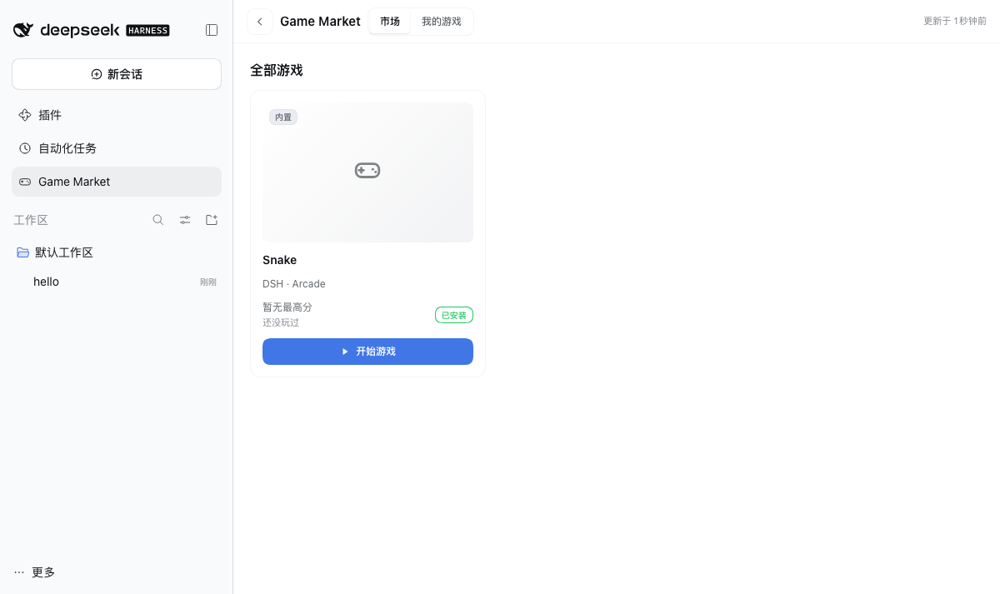 | 点击「游戏」直接进入 Game Market |
| 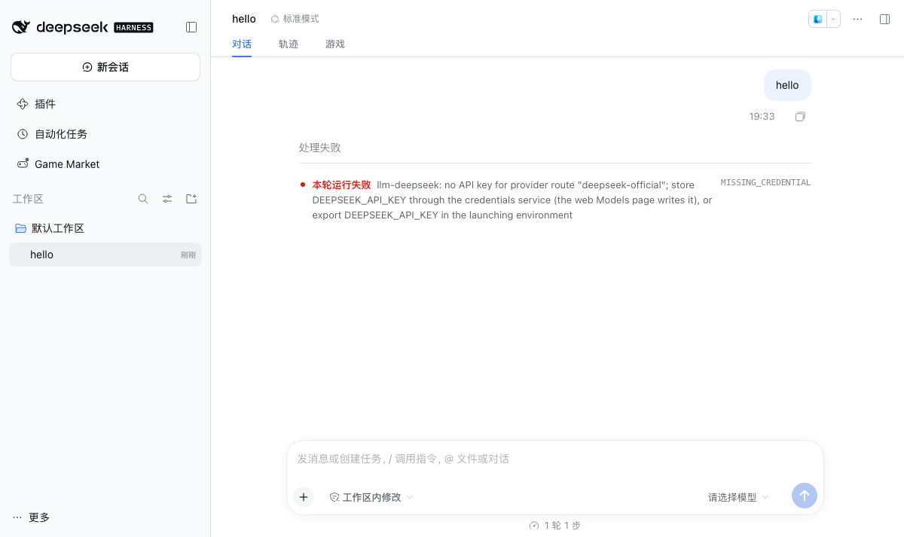 | 从市场返回后仍是正常对话 |
| 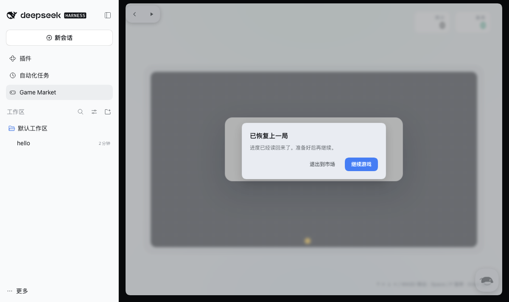 | 恢复时只有平台这一处确认 |
| 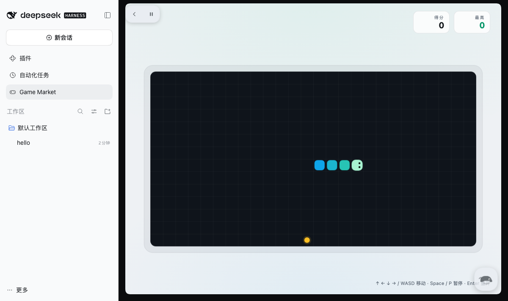 | 确认后直接开始游戏，无第二个遮罩 |

自动化：`npm test` → **314 tests / 314 pass**。

## 4.3 V0.3 修复（2026-10-18 晚第三次）

**现象**：Agent 在真实 DSH 中完成任务后，游戏内没有任何完成提醒。

**根因**：Host 的 agent 状态来自 `ctx.on('turn/end' / 'tool/result' / 'approval/asked' …)`，但 DSH 中这些是 **session log 事件**，不是 Cordis 事件总线事件；真实宿主上这些监听永远不会触发。Cordis 层可用的只有 `agent/pre-step` / `agent/disposed`，所以此前“Agent 正在工作”能出现，而“完成/等待”永远收不到。

**修复**：Host 增加 `ctx.on('session/event', (session, event) => …)` 桥接，按真实 payload 映射：
- `turn/end` 的 `reason.kind`：`completed` / `max-tokens` → completed；`error` → error；`aborted` / `interrupted` / `blocked` / `forked` → idle
- `approval/asked` → waiting-user（approval），`approval/decided` → running
- `turn/start` / `tool/call` / `tool/result` / `assistant/message` → running（tool/call 保留具体工具 label）
- 保留 `agent/pre-step`（Cordis waterfall）与 `agent/disposed`

**验证**：
- 真机（隔离 DSH 0.2.1-rc.2）：发送一条没有模型凭据的消息触发真实 `turn/end(error)`，Host agent-state 在约 6s 内返回 `state=error, seq=2, source=turn`（修复前会一直 idle）。
- 单测覆盖 session-event 的完成/错误/取消/等待审批/工具 label/ack 全链路；鲸鱼完成提醒 UI 继续由 dev 状态与集成测试覆盖（截图）。
- **注意**：本次改的是 Host 半，需要重启 DSH 才生效。

| 截图 | 内容 |
|---|---|
| 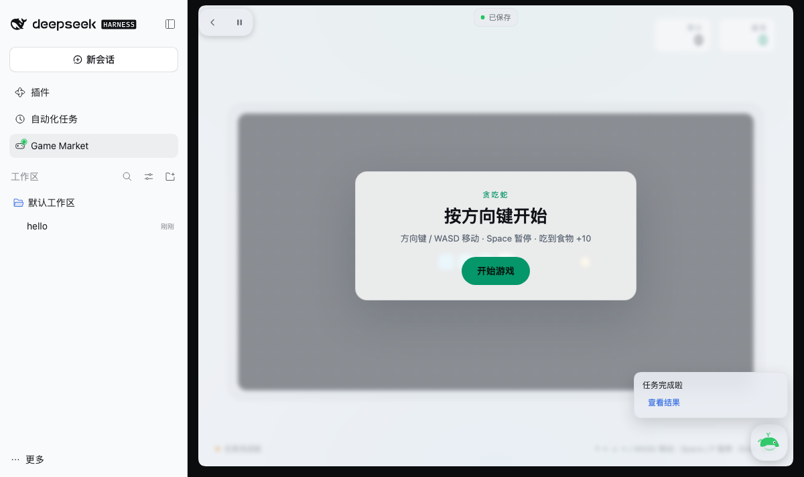 | 游戏内完成提醒（鲸鱼气泡） |

## 5. 未覆盖项与已知限制

1. **真实 Agent 事件链路**：V0.3 起 Host 已改订阅 `session/event`，并在真机验证了真实 `turn/end(error)` 的映射；审批/提问类真实事件仍主要靠单测与 dev 模拟（question 投影未接），仍需真机补测。
2. **提问（question）等待**：V0 只保证 approval 类等待可识别；`userQuestions` 投影未接（PRD S-14），等待态通过 dev 路由验证。
3. **深色主题 / Windows**：平台 UI 全部使用 DSH token；Live 仅验证浅色 + macOS Web 宿主。深色主题与 Windows 复测列入 V1 前检查（PRD §10.1）。
4. **保存失败重试 backoff / saveGap 提示**：V0 简化为失败即提示 + `saveStale` 确认，未实现 PRD 的三次退避与“上次未保存”提示。
5. **桌面窗口**：使用同版本 Web 宿主验证；桌面 Electron 窗口的 chrome/拖拽带不影响本次新增 UI 逻辑。
6. **原子写跨进程 CAS**：单 Host 进程场景验证通过；多 profile 并发写同一存档仍是 last-write-wins（V0 无影响，V1 前再收敛）。
7. **CSP `frame-ancestors *`**：V0 为兼容 Host 实际看到的内部 origin 而放宽；游戏内容不可信且受 sandbox 隔离，V1 改为配置化 allowlist（见项目记忆 V0-06）。
