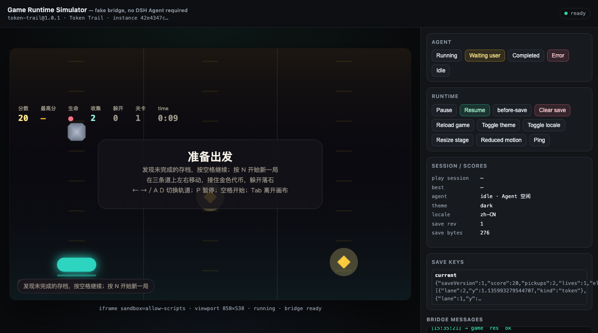
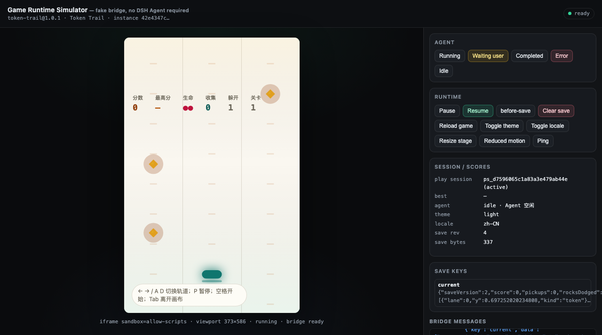
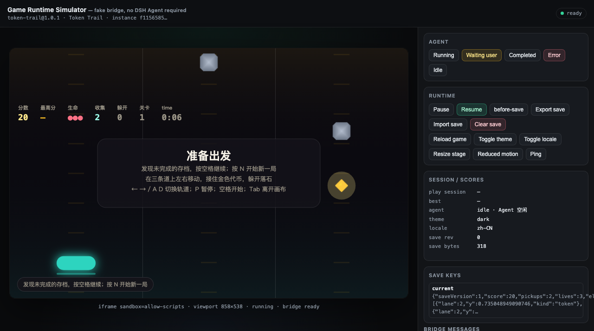

# V1.5 M2-F2 · 独立 AI 仅凭 Skill 的资源包开发评估（验收项 A09）

- 日期：2026-10-20
- 评估身份：**独立第三方作者 AI**。只使用 `skills/dsh-game-developer/SKILL.md`（v1.1.0）+ 其 `references/**` + 仓库内公开文档；不复用平台内部实现知识。
- 参考仓库（只读）：`<repo>`（本机 M2 工作树 `v1.5-game-and-tooling`），head `9388b37`（M2 工作树，未提交改动若干），Skill 版本 `1.1.0`，CLI 版本 `0.1.0`。
- 隔离工程：`<work>` = `/tmp/m2-skill-eval/token-trail`（所有源码、构建产物、publish 输出都只写这里；仓库只写本报告与 `raw/m2/skill-eval/**`）。
- 最终结论：**有缺陷（核心作者链路 PASS，Skill 自足性 12 项缺陷，其中 3 项 P1）**。 **round-2 复验（lead 修复后）见 §12：3 条 P1 与 PD-1..PD-6 全部 CLOSED；新增 1 条 P2 文档失配。**从零做出可玩 `asset-zip-v2` 游戏、构建/校验/打包/确定性/非法包修复/升级与旧档兼容/投稿材料/Simulator 全部真跑通过，但 Skill 在环境前提、旧档跨版本验证步骤、投稿材料可执行步骤上仍需补写；另有 6 项产品/工具文案与实现不一致（见 §8）。

## 1. 评估摘要（逐项判定）

| # | 验收动作 | 结果 | 证据 |
|---|---|---|---|
| 1 | 仅按 Skill 从零做 `asset-zip-v2` vanilla 游戏（键盘/计分/暂停/自动保存） | ✅ 完成，可玩（含 ESM 源码、外部 CSS、PNG 素材、WAV 音效、关卡 JSON） | `01-create.log`、`03-build-1.0.0.log`、截图 |
| 2 | `validate` / `pack` / `validate 最终 ZIP` | ✅ 全 exit 0；v1.0.1：`sha256 29a3f8a5…`、147769 bytes、fileCount 12、filesDigest `def50059…`、self-test `extracted OK (13 entries @0444)` | `04-gate-1.0.0.log`、`14-gate-determinism-1.0.1.log`、`29-npm-wrappers-1.0.1.log` |
| 3 | 确定性：两次 build/pack 字节一致 | ✅ build 树哈希两次相同；pack sha256 两次相同（1.0.0 与 1.0.1 各自） | `05-determinism-1.0.0.log`、`14-gate-determinism-1.0.1.log` |
| 4 | 非法包 → 修复 → 重验（≥2 类） | ✅ 4 类真实非法输入全部被拒并记录原始错误；修复后全量重跑通过 | `06`–`11` 日志 |
| 5 | 1.0.0 → 1.0.1 升级 + 旧 save 兼容 | ✅ 版本/清单/save schema 升级后全量 gate 通过；真实浏览器把 1.0.0 存档载入 1.0.1 build，Continue 恢复旧值并写回 v2 存档；损坏存档安全重开 | `16`–`18`、`28` 证据 + 截图 |
| 6 | 投稿材料生成与校验 | ✅ `publish` dry-run 零写入、正式 publish 产出 3 件套；`submission.draft.json` 用平台 validator draft 模式校验通过（final 模式按预期因 pending 被拒） | `22`–`27` |
| 7 | `dev`（Simulator）跑一次 | ✅ 1.0.0 与 1.0.1 各跑一次：`/health` 200 且 `format: asset-zip-v2`、fileCount 12；CDP 真实键盘操作、暂停/恢复、before-save、Continue、375px、明暗主题、reduced-motion、零外部请求 | `15`、`20`、`21`；`16`/`18`/`19` 浏览器证据 + 截图 |
| 8 | 自足性清单 | ✅ 见 §9：20 条「Skill 没写必须猜」，0 条「Skill 写了但命令直接失败」 | 本报告 |

## 2. 泳道与命令（全部真跑；日志已脱敏）

所有命令都在隔离工程目录执行；`DSH_GAME_CLI="<repo>/scripts/cli/dsh-game.mjs"` 由环境变量提供（Skill §4 要求，但赋值本身需要作者自己找路径，见缺陷 P1-1）。逐条命令+exit code 汇总见 [`03-commands-and-exit-codes.json`](raw/m2/skill-eval/03-commands-and-exit-codes.json)。

```text
create      node "<repo>/scripts/cli/dsh-game.mjs" create token-trail --dir . --template vanilla \
              --format asset-zip-v2 --name "Token Trail" --description "…" --author "Independent Author"   exit 0
build       npm run build                                                                                 exit 0
validate     node "$DSH_GAME_CLI" validate . --format asset-zip-v2 --json                                exit 0
             node "$DSH_GAME_CLI" validate dist --json                                                    exit 0
pack         node "$DSH_GAME_CLI" pack . --format asset-zip-v2 --json                                     exit 0
validate zip node "$DSH_GAME_CLI" validate dist/token-trail-1.0.0.dshgame.zip --json                     exit 0
determinism  npm run build ×2 + pack ×2                                                                  exit 0（两次 sha256 相同）
illegal A/B  npm run build（内联 <script> / 外链 CSS）                                                    exit 1 + 原始错误
illegal C/D  node "$DSH_GAME_CLI" validate dist（陈旧描述符 / 归档内联）                                    exit 1 + GM 码
fix + gate   重新 build → validate → pack → validate                                                     exit 0
upgrade      manifest/package 1.0.1 + save.schemaVersion 2 + 迁移代码 → 全量 gate                          exit 0
wrappers     npm run validate；npm run pack                                                              exit 0
dev 1.0.0/1  node "$DSH_GAME_CLI" dev . --format asset-zip-v2 --port 4401/4402（长驻，被操作者停止）      启动成功
publish      ... publish . --format asset-zip-v2 --dry-run --url … --cover … → 正式 publish                exit 0 / exit 0
submission   node 校验器 validateSubmission(draft, {mode:'draft'})                                        exit 0
final 负例   validateSubmission(doc, {mode:'final'})                                                     返回 ok:false（8 个 pending 未解决；校验脚本按 draft 结果 exit 0）
```

## 3. 游戏与包摘要

- 游戏：**Token Trail**（`token-trail`，arcade，三条轨道收集金色代币、躲避落石；←/→ 或 A/D 换道、P 暂停、空格开始/继续、M 静音；分数/最高分/生命/收集/躲开/关卡/时间 HUD；自动保存 + Continue；zh/en 文案）。
- 资源包结构（dist）：`index.html`、`game.json`、`dsh-package.json`、`dsh-sdk.js`、`scripts/main.js`、`styles/styles.css`、`assets/{token,rock}.png`、`audio/{pickup,hit}.wav`、`levels/level-01.json` + 模板自带的两个 README.txt（共 12 个文件）。
- 构建确定性：两次 `npm run build` 后 dist 文件树 sha256 聚合（不含 zip）均为 `a9f71da4…`。
- 包摘要：

| 版本 | zip sha256 | size | fileCount | filesDigest | self-test |
|---|---|---|---|---|---|
| 1.0.0 | `0543f98935f48f2e06b2459a6ea9cd8e61ce706c06645d618220249f576611e4` | 147108 | 12 | `64a5e859b309ecb624230ef069b98e74bc4f5af4bb25c7b383ac9839e7fd7f2e` | extracted OK |
| 1.0.1 | `29a3f8a5361946c3e2ce7bca77b56f61f4c4fab57e1333a3e1000f67fa1d167a` | 147769 | 12 | `def50059c425af29fb02b68b87d70140cef8f04c352ddb5879feb8f2b3ae94e1` | extracted OK (13 entries @0444) |

- 1.0.0 包在升级前后未改动（sha256 与首次构建一致），符合「已发布字节不可变」。
- `registry-entry.json` 与 `submission.draft.json` 的 package 三值（sha256/size/filesDigest）一致（`01-artifact-summary.json#registryEntryMatchesSubmissionPackage: true`）。

## 4. 非法包 → 修复 → 重验（4 类，原始输出逐字）

**A. 构建期内联 `<script>`**（index.html 中加入 `<script>window.__illegalInline = true;</script>`）→ `npm run build` **exit 1**：

```text
error: asset-zip-v2 packages must not contain inline <script> blocks (contract D-C)
  hint: Move the code to the project entry file; the CLI emits scripts/main.js.
```

与 Skill §5 示例逐字一致。修复：删除内联块 → build exit 0（`07-illegal-a-fix.log`）。

**B. 构建期外链样式**（`<link rel="stylesheet" href="https://cdn.example.com/x.css">`）→ **exit 1**：

```text
error: External stylesheet is not allowed in asset-zip-v2: https://cdn.example.com/x.css
  hint: Ship the CSS inside the package.
```

修复：移除外链、保留包内 `src/styles.css` → 后续 build exit 0。

**C. 归档级陈旧描述符（GM-4278）**：build 后手工向 `dist/scripts/main.js` 追加一行再 `validate dist` → **exit 1**：

```text
FAIL  <work>/token-trail/dist (0 bytes)
  1. E_DESCRIPTOR_MISMATCH (GM-4278) files: descriptor file manifest does not match the package
  2. E_DESCRIPTOR_MISMATCH (GM-4278) files: size mismatch for scripts/main.js
```

与 Skill §5 第 4 条逐字一致。修复：重新 `npm run build`（不手工改 dist/描述符）→ validate exit 0。

**D. 归档级内联内容（GM-4283）**：向 build 后的 `dist/index.html` 注入内联 `<script>` 并同步更新 `dsh-package.json` 的 size/sha256（复现 Skill §5 第 3 条场景）→ `validate dist` **exit 1**：

```text
FAIL  <work>/token-trail/dist (0 bytes)
  1. E_ASSET_INLINE_FORBIDDEN (GM-4283) entry: HTML is not package-safe: index.html
```

修复：重新 build → 全量 gate 通过，且最终 1.0.0 sha256 回到原来的 `0543f989…`（证明可复现）。

## 5. 1.0.0 → 1.0.1 升级与旧存档兼容

**改动（均按 Skill 说明执行）：**

1. `manifest.json`：`version 1.0.0 → 1.0.1`；`save.schemaVersion 1 → 2`（存档 shape 新增 `rocksDodged` 键）。
2. `package.json`：`version → 1.0.1`（Skill §6.1 只提 manifest；references §5.1 才提到 "package.json-style project metadata"，见缺陷 P3-6）。
3. `src/storage.js`：`SAVE_VERSION 1 → 2`；`deserializeState` 同时接受 `saveVersion === 1` 与当前版本，旧档缺 `rocksDodged` 时补默认值 0，绝不丢旧键；未知版/已结束/0 命/非对象仍返回 `null`（安全重开）。
4. 游戏逻辑：把「落石从身边掠过」计入 `rocksDodged` 并显示在 HUD；`serializeState` 写入新键。

**升级后 gate 全通过**（`14-gate-determinism-1.0.1.log`、`29-npm-wrappers-1.0.1.log`）：`npm run build`/`validate`/`pack`/`validate` 均 exit 0；`pack` 输出新 sha256 `29a3f8a5…`、filesDigest `def50059…`；连续两次 build+pack 字节一致。

**旧存档兼容证据（真实浏览器 + 代码断言）**

- 先在 1.0.0 的 Simulator 里真实玩了一局（真实键盘事件），P 暂停/`before-save` 控件触发 `storage.save`，页面显示存档：`{"saveVersion":1,"score":20,"pickups":2,"lives":1,"elapsed":9.549526…,"lane":0,…}`（`16-sim-1.0.0-run-evidence.json`；UI 显示 240 字符截断，其余字段按冻结的 1.0.0 `serializeState` 助手重建，见下文未验证项）。
- 在 **1.0.1** Simulator 中把该 1.0.0 存档注入 fake host（页面 `state.save.current`）后点 **Reload game**：1.0.1 构建收到 `storage.load` 返回旧 shape 存档，界面显示「准备出发 / 发现未完成的存档，按空格继续」，HUD 直接显示恢复的 分数 20 / 收集 2 / 生命 2 —— Continue 生效（截图：[01-continue-offered-with-1.0.0-save.png](raw/m2/skill-eval/screenshots/01-continue-offered-with-1.0.0-save.png)）。
- 按空格继续后真实游玩/暂停，bridge 记录 `storage.save` 写回 **saveVersion 2**，旧值保留（score 20、pickups 2、elapsed 从 9.55 继续增长），新键 `rocksDodged: 0`（`18-browser-save-migration-evidence.json#saveAfterMigration`）。
- 损坏/未知存档（`{"saveVersion":99,"score":500}`）→ 1.0.1 正常启动、不做 Continue、开始新局并写回 v2 存档，无 console 错误（`18-…evidence.json`）。
- 代码级断言（16 条检查全过，exit 0）：旧字段逐个保留、新键默认 0、未知版/已结束/0 命/null/数组全部拒绝（`28-save-migration-node-assertions.json`）。





## 6. 投稿材料

- `publish --dry-run`（ZIP）：exit 0，打印 `(dry run: no files written)`，dist 无新文件。
- `publish`（正式，离线）：exit 0，写出 `dist/registry-entry.json`、`dist/upload-plan.md`、`dist/review-checklist.md`；registry entry 含 `package.format: "asset-zip-v2"`、`sha256`、`size`、`filesDigest`。
- `submission.draft.json`：按 `references/submission.md` 与 `templates/registry/examples/submission-zip.example.json` 生成（`submissionType: "update"`，含 1.0.1 changelog、`saveCompatibility: "compatible"`、真实 sha256/size/filesDigest、真实截图 sha256/size、license/selfTest、pending[]）。
- 校验：用 Skill 指向的 validator（`packages/shared/src/community.js#validateSubmission`）：
  - `mode: 'draft'` → **ok: true，errors: []，8 个 pending 字段被接受**（作者身份/公开 URL/媒体 URL 未就绪）；
  - `mode: 'final'` → 如预期被拒（`author.login`、`package.url` 等 8 个 remote 字段必须补齐），证明 draft/final 边界真实存在（`27-submission-validation.json`）。
- 未做：公开托管、真实 GitHub 身份、review 记录（维护者所有）、catalog 写入（维护者工具），按 Skill 边界列为 pending。
- `author.sourceCommit` 是隔离工作目录内本地 git commit（未公开托管，只用于满足 draft 的固定 commit 字段）；公开源码仓库 URL 仍 pending。

## 7. `dev`（Runtime Simulator）实测

- 启动命令：`node "$DSH_GAME_CLI" dev . --format asset-zip-v2 --port 4401/4402`（Skill 只写 `npm run dev`；`--port`/`--no-build` 只在公开 guide §5 有，Skill 未写 → 缺陷 P2-3）。两个版本都能启动，打印 URL；被操作者停止（长驻进程，无法给出「自然退出码」）。
- `/health`（1.0.1）：`{"ok":true,"simulator":true,"build":true,"format":"asset-zip-v2","fileCount":12,"game":{"id":"token-trail","version":"1.0.1"}}`，ASCII 200。
- CDP 真实交互（1.0.0 与 1.0.1 各一轮）：
  - 页面真实键盘（空格开始、←/→ 换道），分数/生命变化，存档里 score=20/pickups=2 等真实写入；
  - P 暂停触发保存；暂停期间经过 1.6s 再触发 before-save，`elapsed` 不变（4.7332 → 4.7332）；恢复 1.3s 后再暂停，`elapsed` 增至 6.1497 → **暂停时长不计入游戏时间**；
  - `before-save` 控件触发桥 `storage.save` 并收到 `res ok`；
  - 375px 舞台（frame 375×588）、light/dark、reduced-motion 均可切换并截图；HUD 位于平台顶部 112px 安全带之下，canvas 全出血；
  - 资源全部为 localhost 请求（`/res/<instance>/<nonce>/…`），**0 个外部请求**、0 个 console 错误；
  - ZIP 模式是「平台 wrapper（外层不 sandbox）→ 游戏 iframe（sandbox=allow-scripts）」两层结构（Skill 未说明，guide §10.6 有 → P3-5）。
- 限制：Simulator 是一次性浏览器 harness（内存存档、假 Host），不等于真实 DSH Desktop 安装/持久化/多窗口。

## 8. 产品/工具缺陷（不是 Skill 文案问题；只记录，最小复现）

| ID | 严重度 | 现象 | 最小复现 | 建议 |
|---|---|---|---|---|
| PD-1 | P2 | ZIP 包的 `publish` review checklist 仍写 "Package validates as a single-file, self-contained HTML package."（与实际 ZIP 包矛盾，会误导作者/复核者） | `node "$DSH_GAME_CLI" publish . --format asset-zip-v2 --url … --cover …` 后看 `dist/review-checklist.md` 第 3 行 | 按 `package.format` 分支生成 checklist 文案 |
| PD-2 | P2 | `upload-plan.md` 打印的字段名是 `fileManifestDigest`，而 registry-entry / 契约 / submission 用 `filesDigest`（同值不同名） | 同上，看 `dist/upload-plan.md` 第 5 行 | 统一为 `filesDigest`（或注明二者同一值） |
| PD-3 | P3 | `validate dist` 的失败头行固定打印 `(0 bytes)`，与实际包大小不符 | 篡改 `dist/scripts/main.js` 后 `node "$DSH_GAME_CLI" validate dist` | 用实测字节数 |
| PD-4 | P3 | `dsh-game dev --help` 打印的是全局 help，看不到 `--port`/`--no-build` 等 dev 选项 | `node "$DSH_GAME_CLI" dev --help`（与 `--help` 输出相同） | 增加 dev 专属 help 段 |
| PD-5 | P3 | `create` 生成的 vanilla ZIP 工程里残留模板文案：`src/main.js` 头注释 "Orbit Catch…"、`src/render.js`/README 中模板示例内容 | `node "$DSH_GAME_CLI" create demo --dir . --template vanilla --format asset-zip-v2` 后查看 `src/main.js` 前 5 行 | 用 `--name`/`--description` 替换或去掉模板专属文案 |
| PD-6 | P3 | 公开 `docs/developer-guide.md` §5 说开发服务器 "在 /game 提供最新产物"，ZIP 模式 `curl /game` 实际 404（真实入口是 `/wrapper?src=…`） | `npm run dev` 后 `curl -i http://127.0.0.1:4321/game` | 文档按 format 分支说明入口 |

## 9. 自足性清单

### 9.1 「Skill 没写、我必须猜」的条目（20 条）

1. **仓库需要 `npm install`（yauzl 依赖）**：Skill 明确写 "the toolchain has zero npm dependencies and works offline"，但 M2 工作树 `package.json` 含 `yauzl@3.4.0`；干净 clone 未 `npm install` 时 ZIP validate/pack/dev 能否工作未知（本评估依赖了仓库已有 `node_modules`，见未验证项）。这是 P1。
2. `DSH_GAME_CLI` 的实际值（`<repo>/scripts/cli/dsh-game.mjs`）与「路径含空格要引号」；生成工程的 README 里仍是 `/path/to/...` 占位。
3. 在仓库外（`/tmp`）建工程时，`scripts/cli.mjs` 的 fallback（`../../scripts/cli/dsh-game.mjs`）无效，必须 export 环境变量——Skill 说了要 export，但没说清 fallback 只在仓库模板目录下有效。
4. `create --name/--description/--author` 会写进 `manifest.json`（i18n `title` 也来自 `--name`）；Skill 未说明这些 flag 的落点。
5. `index.html` 里引用**源路径** `src/styles.css`，build 会改写为 `styles/styles.css`；Skill/模板 README 说会变成 `styles/game.css`（实际不是，P3）。
6. `assets/`、`levels/`、`audio/` 由 `dsh-game.config.json#resources` 自动复制进 dist；Skill 未解释 `resources` 字段。
7. `levels/*.json` 的 schema 无 define/无校验（模板给 `level/spawnIntervalMs/speed`）；作者可自定义，但 Skill 未说明「关卡 JSON 是否有契约」。
8. 资源文件允许的扩展名/MIME 清单（png/webp/jpeg/gif/svg/ogg/mp3/wav/m4a 部分只在模板 README 出现；`package-and-sdk.md` 只给总量限制）。
9. `game.runtime.assetUrl()` 在 Simulator 中的返回值形状（绝对 URL）与 html-v1 的 `GM-4043` 行为；Skill 提了函数但没给试跑方法。
10. `game.score.submit()` / `session.start()/end()` 的返回形状与错误码（`GM-4006`、`GM-4031/4032/4033/4093`）——Skill 只在正文零散提到部分码，完整签名要读 `sdk/index.d.ts` 或模板。
11. `save.schemaVersion` 提升后**平台侧行为**（是否提示兼容性、是否影响 Continue 判定、是否按 schemaVersion 拒绝）Skill 未描述；只能推断「相同 schema 视为同 schema」。
12. `before-save` 的 deadline（Simulator 日志为 `deadlineMs:800`）与保存超时要求；Skill 只说「处理 before-save」。
13. 主题/reduced-motion 的字段来源：`game.ready()` 返回 `{locale,theme,reducedMotion}`，运行期用 `game.runtime.theme/reducedMotion`；Skill 只给原则，具体字段名靠模板。
14. `publish` 的 `--url` 约束（ZIP 必须 `.dshgame.zip`、https、host allowlist 默认 GitHub）与 `--cover` 的约束；`dsh-game --help` 还写着 `must end with <id>-<version>.html`（与 ZIP 冲突，P2）。
15. CLI `--json` 输出的字段集（validate: bytes/source/fileCount/filesDigest；pack: sha256/bytes/permissions/selfTest）；Skill 只提到部分。
16. `dev` 的 `--port`/`--no-build`、`/health`、就绪判断、如何停止；Skill 只写 `npm run dev`。
17. 无 GitHub 身份/无公网托管时投稿材料的 `pending[]` 用法和**允许 pending 的字段白名单**——只在 validator 源码里（`author.login`/`githubUserId`/`sourceRepo`/`package.url`/`sha256Url`/`media.*.url`），Skill 未列。
18. 1.0.1 升级后旧 `dist/registry-entry.json` 会被覆盖，需先拷贝到版本化位置——`references/verification.md` §5.5 有，SKILL 主文 §6 未强调。
19. 自定义 i18n 字典 key 无约束/无必填集合；模板自带；Skill 未说明本地化验收要求。
20. `game.onError` 与各 GM 码的表现处理（哪些必须可见、哪些可静默默认）Skill 未给完整表。

### 9.2 「Skill 写了但命令实际失败」的条目

**没有**：Skill §0/§4 列出的 create/build/validate/pack/publish(--dry-run)/dev 命令全部实际执行成功（exit 0）。失败只出现在**故意构造的非法包**（4 类，符合 Skill §5 文档）与**产品/文档不一致**（§8）上。

## 10. Skill 缺陷清单（按严重度）

**P1（不补写会让独立作者卡住/走错路）**

1. **环境前提与事实矛盾**：SKILL §Before you start 写 "Node.js ≥ 20; the toolchain has zero npm dependencies and works offline"，但 M2 工具链依赖 `yauzl@3.4.0`（仓库 `package.json`）。Skill 必须写明「先 `npm install`（ZIP 校验/打包需要 yauzl）」或说明离线 vendor 方案；否则干净 clone 的作者在 `validate/pack` 阶段会失败且不知原因。证据：`<repo>/package.json`、本次评估环境。
2. **1.0.0→1.0.1 旧存档验证步骤不可执行**：SKILL §6.4 / `references/verification.md` §5.4 要求「在 Simulator 用 1.0.0 build 存档 → 加载 1.0.1 build → 确认 Continue」，但 Simulator 一次只服务启动时载入的一个构建快照，存档只存在页面 JS 内存（新开页面为空），UI 只有 Clear save、没有导入/导出。作者无法按字面复现；本次通过「页面 `state.save` 注入 + Reload game」完成（内部手段）。Skill 需给出可执行步骤（如 `--save-file`/导入按钮/明确写「逻辑层验证」并给 payload 模板）。
3. **投稿材料只有"在哪/长什么样"，没有"怎么生成/怎么校验"**：SKILL §7 指向 `references/submission.md` 与 contracts §2，但未给 `submission.draft.json` 的生成步骤、`pending[]` 的可用字段白名单、`validateSubmission(input,{mode:'draft'})` 的调用命令。本次只能读 validator 源码逆推。建议在 Skill 里加一段「draft 模式 + pending 白名单 + 一条 node 校验命令」。

**P2（显著多花时间/可能产出错误材料）**

4. **ZIP publish 的 URL 约束缺失且 CLI 帮助自相矛盾**：Skill 未写 `--url` 必须 `.dshgame.zip`/https/allowlisted host；`dsh-game --help` 仍写 "must end with `<id>-<version>.html`"。建议 Skill 明确 ZIP 的 URL/cover 规则。
5. **`filesDigest` 与 `fileManifestDigest` 命名混用**：SKILL §7/submission 用 `filesDigest`，`publish` 的 upload-plan 打印 `fileManifestDigest`（同值不同名），references 两处混用。作者不知道 submission/catalog 该填哪个。建议统一并注明「同一值」。
6. **dev 的自测入口未写**：`npm run dev` 之后怎么确认就绪（`/health`）、怎么指定端口、ZIP 模式的两层 iframe、如何停止；`dev --help` 也不给这些（PD-4）。
7. **`save.schemaVersion` 升级后的平台语义未写**（是否提示、是否影响 Continue、是否需要 submission 的 `saveCompatibility` 说明），只写「平台按相同 schemaVersion 视为相同 schema」；作者只能推断。

**P3（文档瑕疵/误导）**

8. 模板残留 "Orbit Catch" 文案（PD-5）。
9. `styles/game.css` vs 实际 `styles/styles.css`（§9.1-5）。
10. `validate dist` 的 `(0 bytes)` 误导（PD-3）。
11. `publish` 的 review-checklist 对 ZIP 仍写 single-file HTML（PD-1）。
12. `package.json` 版本是否需要随 manifest 一起 bump，SKILL §6.1 与 references §5.1 不一致。
13. ZIP dev 模式两层 iframe 结构未在 SKILL 说明（guide §10.6 有）。

## 11. 未验证项（如实列出）

1. **真实 DSH Desktop 安装/游玩**未做（作者侧 Skill 范围是 Simulator；真实安装/持久化/多窗口需另一轮真机验证）。
2. **干净 clone 无 node_modules 的失败复现**未做（不修改只读仓库）；P1-1 依据是仓库 `package.json` 依赖与本次环境事实，未亲自复现失败命令。
3. **1.0.0 存档 payload 的部分字段为重建值**：Simulator UI 只显示前 240 字符，`objects` 数组尾部与 `spawnIn/speed` 按冻结的 1.0.0 `serializeState` 助手重建；`saveVersion/score/pickups/lives/elapsed/lane` 为真实记录值。迁移断言覆盖所有旧键，但不声称是完整原始字节。
4. **封面/截图**来自 Simulator 的真实游戏画面（非专门设计封面，未公开托管）；submission 里 URL 均 pending。
5. **html-v1 路径**未评估（本次验收目标是资源包；Skill 声称双格式，未交叉验证）。
6. **发布不可变性/同版本换字节/多版本 catalog v2 投影**未做（维护者工具与内容仓库边界）。
7. **网络边界**只验证了「Simulator 内 0 外部请求」；真实 Runtime 的 CSP/资源 origin 行为属 M1/M2 其他验收项，不在本评估。
8. `publish --registry-dir`（ZIP 未接通，Skill 已声明）与 `--file-registry` 未测。


## 12. 修复后复验（round 2）

- 复验日期：2026-10-20（lead 修复后）
- 基线：`<repo>` 工作树（head `9388b37` + M2 修复未提交改动）；Skill 文档在复验开始后仍在更新（`SKILL.md` mtime 16:30，`VERSION` 仍 `1.1.0`），本节的 Skill 文案检查以 16:30 之后的文件为准。
- 复验范围（按 lead 要求只验修复项）：Skill P1-①（npm install 前置）、产品 P1-A（无 node_modules 可操作报错）、产品 P1-B（dev-only 旧存档桥）、Skill P1-③（投稿材料可执行）、产品缺陷 PD-1..PD-6、以及「dev save 端点是否泄漏到生产」。
- 隔离方式（未改仓库实现）：排除 `node_modules`/`.git` 的仓库副本 `<work>/repo-nodeps`；沿用 round-1 的隔离工程 `/tmp/m2-skill-eval/token-trail`（1.0.1）与 `token-trail-sim`（1.0.0），新产物全部在 `<work>/logs`。仓库写入仅本报告与 `raw/m2/skill-eval/round2/**`。
- **结论：3 条 P1 全部 CLOSED；PD-1..PD-6 全部 CLOSED；dev save 端点未泄漏到生产 Host。复验中新发现 1 条 P2 文档失配（Skill 对"缺依赖时失败形态"的描述仍写旧行为）+ 2 条 P3（human 输出不带错误码；Skill VERSION 未 bump）+ 1 条 P3 观察（import 与在途存档的竞态）。**

### 12.1 P1 关闭情况

| P1 | 状态 | 复验证据 | 复验结果 |
|---|---|---|---|
| **P1-① Skill「零 npm 依赖」** | ✅ **closed**（前置条件已写清） | SKILL.md §Before you start L20–34 明确 `npm install`/`npm ci`、`yauzl@3.4.0`+`pend@1.2.0`、html-v1 不需要；`references/package-and-sdk.md`、`references/verification.md` 同步 | 无 `node_modules` 副本中 **html-v1 `build` exit 0**；ZIP `validate`/`pack` 不再报裸模块错误，而是 **exit 2** + 可操作 hint（见 P1-A）。**但** §12.4 N1：三处文档仍把失败形态写成旧行为，需再改文案（不影响 P1-① 关闭判定） |
| **P1-② 旧存档 Simulator 验证不可执行** | ✅ **closed** | SKILL.md §6.4 + `references/verification.md` §4/§5 给出可执行流程；dev-only `--save-out`/`--seed-save`/`GET /dev/save/export`/`POST /dev/save/import` + UI Export/Import 按钮全部实测 | 按 Skill 流程真跑通：1.0.0 `--save-out` 导出 `saveVersion:1`（score 20 / pickups 2 / lives 3 / elapsed 6.55）→ 1.0.1 `--seed-save` 启动（`/health hasSeedSave:true`）→ Continue 可见且 HUD 恢复旧值（截图 `screenshots/01`）→ 继续游玩并写回 `saveVersion:2`（score 40 / pickups 4 / rocksDodged 1）。损坏/未知档 fresh start；错误 seed 文件 exit 2 + hint。端点只在 dev server（P1-B 见 §12.2） |
| **P1-③ 投稿材料不可执行** | ✅ **closed** | SKILL.md §7 新增「Executable draft generation」+「Validate it」两段代码 + pending 白名单 + URL 规则 | 按原文逐字执行：generation **exit 0**；`publish --dry-run --json` 输出含 `.entry`；validation **exit 0**，`draft.ok:true`、空格 `errors:[]`、8 个 pending 字段被接受（`raw/.../round2/18`、`27`） |

### 12.2 产品 P1-A / P1-B 复验

**P1-A（无 node_modules 时的可操作失败）——closed**

| 命令（无 `node_modules` 副本 `<work>/repo-nodeps`） | exit | 实际输出 |
|---|---|---|
| `create html-demo --template vanilla --format html-v1` | 0 | 生成成功 |
| `build html-demo --format html-v1` | 0 | `built …/dist/index.html (123353 bytes)` |
| `validate <packed .dshgame.zip> --format asset-zip-v2` | **2** | `error: Missing toolchain dependency: asset-zip-v2 validation/packing needs the repository dependencies (the Host archive reader uses "yauzl")` + `hint: Run npm install (or npm ci) at the repository root, then retry. html-v1 commands work without it.` |
| `validate <project> --format asset-zip-v2` | **2** | 同上 |
| `pack <project> --format asset-zip-v2 --json` | **2** | `{"ok":false,"error":{"message":"Missing toolchain dependency: …","hint":"Run npm install …","code":"E_TOOLCHAIN_DEPS_MISSING"}}` |
| `validate <zip> --format asset-zip-v2 --json` | **2** | 同上，含 `code: E_TOOLCHAIN_DEPS_MISSING` |

**P1-B（dev-only 旧存档桥）——closed**

- 1.0.0 工程：`dev . --format asset-zip-v2 --port 4411 --save-out <file>` 启动成功，`/health` 200（`saveApi:true,hasSeedSave:false,saveOut:"…"`）；真实键盘游玩 + P 暂停后 `--save-out` 文件出现且 `GET /dev/save/export` 返回同一 JSON：`{game:{id,version:1.0.0}, savedAt, save:{current:{saveVersion:1, score:20, pickups:2, lives:3, elapsed:6.5497…, lane:0, objects:[…]}}}`。
- 1.0.1 工程：`dev . --format asset-zip-v2 --port 4412 --seed-save <file>` 启动成功，`/health` 200 且 `hasSeedSave:true`；页面加载时 bridge 记录 `storage.load` 返回该 1.0.0 存档；游戏内显示「发现未完成的存档，按空格继续」，HUD 直接显示恢复值（分数 20 / 收集 2 / 生命 3 / time 0:06）——截图见证据。
- 按空格继续 + 游玩后暂停：`GET /dev/save/export` 返回 `saveVersion:2, score:40, pickups:4, rocksDodged:1, elapsed:11.65`（旧键全保留，新键有值）。
- `POST /dev/save/import`：`{"save":{...}}` → 200 `{ok:true,imported:true,bytes}`；导入整个 `--save-out` 文件（含 `game/savedAt/save` 顶层）→ 200；非法 JSON → 400 `bad_request` + 可读 message；未知 schema 导入被接受（由游戏端决定，fresh start 验证见下）。
- `--seed-save` 未知 schema（`saveVersion:99`）→ 游戏启动 fresh（新存档 `saveVersion:2, score:0`），无 console 错误；`--seed-save` 文件不是 JSON → CLI **exit 2** + `error: --seed-save is not valid JSON …` + `hint: Use the file produced by --save-out (or /dev/save/export).`
- **生产泄漏检查**：`grep /dev/save` 在 `packages/host`、`packages/runtime`、`packages/client` 及仓库非 CLI 源中 **0 命中**；只存在于 `scripts/cli/dev-server.mjs`、`scripts/cli/lib/dev-harness.mjs` 与其测试（`scripts/cli/test/dev-save.test.js`）。符合「生产 Host 不暴露」。

### 12.3 产品缺陷 PD-1..PD-6 复验（全部 closed）

| ID | 复验命令（节选） | 结果 |
|---|---|---|
| PD-1 review-checklist ZIP 文案 | 用新 CLI 对 1.0.1 ZIP 重新 publish → 查看 `dist/review-checklist.md` | ✅ 首行改为 `Package validates as an **asset-zip-v2 resource package** (deterministic ZIP, descriptor + file manifest)`，另有 ZIP entries/0444 专项条目 |
| PD-2 digest 字段命名 | 同上 → `dist/upload-plan.md` | ✅ 统一为 `filesDigest:`，并注明 registry-entry/upload-plan/submission 使用同一字段名 |
| PD-3 `(0 bytes)` 误导 | build 后向 `dist/scripts/main.js` 追加一行 → `validate dist` | ✅ `FAIL  <project>/dist (146409 bytes)`（真实字节数），仍为 GM-4278 + size mismatch |
| PD-4 `dev --help` | `dsh-game dev --help` | ✅ 输出 dev 专属 help（`--port/--host/--no-build/--seed-save/--save-out` + endpoints 列表） |
| PD-5 模板残留 Orbit Catch | 新 CLI `create zip-demo --format asset-zip-v2` → scan `src/`+README | ✅ 0 命中 "Orbit Catch" |
| PD-6 guide `/game` | 查看 `docs/developer-guide.md` §5 | ✅ 明确 `html-v1` 用 `/game`；`asset-zip-v2` 模式「`/game` **故意返回 404**」，入口是 `/wrapper?src=…` + `/res/…`（以及 §10.6 两层 iframe 说明） |

另：复验中重新 `pack` 1.0.1 产物 sha256 仍为 `29a3f8a5361946c3e2ce7bca77b56f61f4c4fab57e1333a3e1000f67fa1d167a`（与 round 1 完全一致），1.0.0 重建 digest 仍为 `64a5e859…`——修复未破坏确定性。

### 12.4 round 2 新发现问题

| ID | 严重度 | 问题 | 最小证据/复现 | 建议 |
|---|---|---|---|---|
| **N1** | **P2（文档失配）** | Skill 新增的「缺依赖失败形态」描述仍是旧行为：`SKILL.md` L27–29、`references/package-and-sdk.md` §1、`references/verification.md` §1/§GM 表都写「`E_ZIP_INVALID (GM-5000)` / module-not-found，ZIP `pack` exits 3」；实测 CLI 已改为 **`E_TOOLCHAIN_DEPS_MISSING`、exit 2**（validate 与 pack 一致，human 输出含 message+hint，`--json` 含 code） | 见 round2 证据目录下的 no-deps-toolchain 与 skill-dep-text-and-json 两份日志 | 三处统一改为：`E_TOOLCHAIN_DEPS_MISSING`（exit 2）+ hint；删除 GM-5000/pack exit 3 的旧表述（或注明 GM-5000 是 Host 安装侧语义）。这是本轮唯一需要再改 Skill 的点 |
| **N2** | P3（可用性） | 非 `--json` 的 `validate`/`pack` 在缺依赖时只打印 message+hint，不打印错误码 token；`--json` 才有 `E_TOOLCHAIN_DEPS_MISSING`。若作者按 Skill 建议用错误码分支，human 模式无法取得 | `round2/01` vs `round2/20` | 在 human 错误行加上 `[E_TOOLCHAIN_DEPS_MISSING]` 或统一输出形式 |
| **N3** | P3（版本纪律） | `skills/dsh-game-developer/VERSION` 仍为 `1.1.0`，但 `SKILL.md`（17KB→28.5KB）与 4 个 references 在 round 2 全部有实质更新 | `ls -la`/`cat VERSION`（`round2/19`） | bump 到 1.2.0（或按项目规范），让消费方区分两版 Skill |
| **N4** | P3（观察，非实现 bug） | 在上一局结束的异步 `session.end → save` 尚未落地时执行 `POST /dev/save/import`，导入内容会被随后的在途 save 覆盖（我注入 corrupt payload 后被上一局 v2 save 覆盖，浏览器因此走的是"已结束存档"分支而非 corrupt 分支） | `round2/23-sim-1.0.1-seeded-continue-evidence.json` 的 `corruptImport` 与 `logAfterCorrupt` 时间线 | 文档提示「无运行中局面时再导入，或先 Clear save」；harness 也可像 `ignoreSavesUntil` 一样在 import 后短暂忽略在途 save。不影响生产 |

### 12.5 round 2 未验证项

- 未重跑整套 round-1 项目（只验修复项）；round-1 的 4 类非法包、确定性、整包 gate 结论不变（产物 sha256 与 round 1 一致已交叉确认）。
- 真实 DSH Desktop 安装/游玩、公开托管/身份/review/catalog、html-v1 全流程等 round-1 未验证项仍不在此轮范围。
- Skill 在复验期间仍在更新（16:25→16:30），若之后再有编辑，N1/N3 的结论需以最终文件为准。

### 12.6 round 2 证据索引（`raw/m2/skill-eval/round2/`）

- 汇总/命令：`00-round2-scope-and-verdicts.json`、`29-round2-commands-and-exit-codes.json`
- P1-A：`01-no-deps-toolchain.log`、`20-skill-dep-text-and-json.log`
- P1-B：`02`–`14`（dev 启动/health/export/import/seed 边界）、`21-exported-1.0.0-save.json`、`22-sim-1.0.0-saveout-evidence.json`、`23-sim-1.0.1-seeded-continue-evidence.json`、`24-sim-unknown-seed-fresh-evidence.json`、`28-recorded-1.0.0-save.json`
- P1-③：`17-skill-draft-generation-inputs.log`、`18-skill-submission-executable.log`、`25-publish-json.json`、`26-pack-json.json`、`27-skill-snippet-submission.draft.json`
- PD 修复：`16-pd-fixes.log`、`15-leak-and-doc-checks.log`、`19-pd6-and-new-issues.log`
- 截图：`screenshots/01-seeded-1.0.0-save-continue-offered.png`、`02-continued-and-paused-on-1.0.1.png`、`03-unknown-seed-fresh-start.png`、`04-1.0.0-run-paused-saveout.png`



## 13. 证据索引（round 1）

`raw/m2/skill-eval/`（round 1 证据；round 2 见 §12.6）

- 环境/汇总：`00-environment.json`、`01-artifact-summary.json`、`02-dist-inventory-1.0.1.json`、`03-commands-and-exit-codes.json`
- 创建/构建/校验/打包：`01-create.log`、`02-build-generated-template.log`、`03-build-1.0.0.log`、`04-gate-1.0.0.log`、`30-pack-1.0.0.json`、`31-pack-1.0.1.json`、`32`–`36` validate JSON、`29-npm-wrappers-1.0.1.log`
- 确定性：`05-determinism-1.0.0.log`、`14-gate-determinism-1.0.1.log`
- 非法包/修复：`06`–`11` 日志、`12-restore-gate-1.0.0.log`
- 升级与存档：`13-old-save-payload-frozen-serialize.json`、`17-old-save-reconstructed-from-ui-values.json`、`16-sim-1.0.0-run-evidence.json`、`18-browser-save-migration-evidence.json`、`28-save-migration-node-assertions.json`
- Simulator：`15-dev-1.0.0.log`、`20-dev-1.0.1.log`、`21-dev-health-1.0.1.json`、`19-browser-presentation-matrix-evidence.json`
- 投稿：`22-publish-1.0.1.log`、`23-registry-entry.json`、`24-upload-plan.md`、`25-review-checklist.md`、`26-submission.draft.json`、`27-submission-validation.json`
- 截图（全部来自真实 Simulator 运行）：`screenshots/01`–`06`

脱敏说明：证据中仓库绝对路径替换为 `<repo>`、隔离工作目录替换为 `<work>`、用户目录替换为 `<home>`，Simulator 的实例/nonce 替换为 `<instance>/<nonce>`/`<hex32>`；包 sha256 与 filesDigest 为公开发布身份，保留原文。
